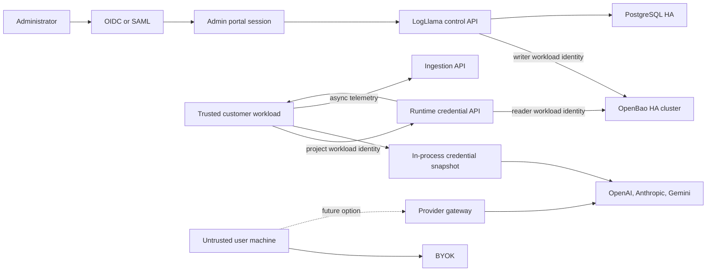

# LogLlama Production Readiness Plan

Last updated: 2026-10-26

## Progress since 2026-07-29

Completed in the product-foundation change:

- Phase 1 (migrations): Alembic with an idempotent baseline and advisory-locked migrations. Startup verifies the revision and performs no DDL.
- Phase 2 (partial): organizations, users, memberships, and roles; email and password sign-in with HTTP-only session cookies and a CSRF header; project-scoped APIs. The shared admin key and `VITE_LOGLLAMA_ADMIN_KEY` are removed. Still open: OIDC/SAML, MFA, audit log, and rate limiting on authentication.
- Phase 3 (partial): API keys are stored as SHA-256 hashes with display prefixes, support expiry and revocation, and are created with a one-time reveal. Still open: overlapping rotation and last-used rate limits.
- Phase 10 (partial): the Python SDK and new TypeScript SDK send batches through a bounded queue, drop and count overflow, and never block a model call.
- Pricing: Anthropic and Gemini models are priced, with tiered rates where published. Unknown models store a null cost instead of zero.

Not started: Phases 4 to 9 and Phase 11, which cover workload identity, OpenBao HA, credential state machines, and comparison-spend controls.

## Purpose

This document is a self-contained execution handoff for making LogLlama's
provider routing, managed credentials, comparison testing, SDK, backend, and
admin portal suitable for public production use.

It is intended to be given to a new coding chat. The new chat should inspect
the repository before editing, preserve the existing uncommitted work, execute
the plan in dependency order, and verify each phase before proceeding.

## Recommended Prompt For A New Chat

> Work through `docs/production-readiness-plan.md` in dependency order. Start
> by inspecting the repository and current git diff. Do not revert existing
> uncommitted changes. Implement the highest-priority incomplete phase end to
> end, including migrations, tests, security checks, and documentation. Keep
> secret-manager calls outside the model-generation path and preserve the
> latency budgets in this plan. Clearly report completed gates and remaining
> blockers.

## Product Context

LogLlama is a public Python SDK and observability platform for OpenAI,
Anthropic/Claude, and Gemini. The current work adds:

- Provider-neutral `LLM.generate(..., provider=...)` routing.
- OpenAI, Anthropic, and Gemini adapters.
- Admin-approved comparison tests that run the same prompt across providers.
- Provider PAT entry through the admin portal.
- Managed credential preload and background refresh.
- Memory, AWS Secrets Manager, HashiCorp Vault, and OpenBao secret backends.
- An admin dashboard for provider credentials and comparison approvals.

The product is not limited to OpenAI. Provider contracts, model switching,
credential handling, instrumentation, and test-mode controls must remain
provider-neutral.

## Non-Negotiable Trust Boundary

A provider PAT delivered to Python on a customer-controlled machine can be
extracted from process memory. A secret manager protects storage and transport,
but it cannot keep a secret hidden after delivery.

The production design must therefore distinguish:

1. Trusted server workloads

   Managed provider credentials may be preloaded into process memory. These
   workloads must authenticate using workload identity and must be explicitly
   authorized for one organization and project.

2. Customer-controlled laptops, desktop apps, browsers, and end-user devices

   Centrally managed PATs must not be delivered to these environments. They
   must use customer-owned credentials (BYOK) or a future LogLlama provider
   gateway. A gateway keeps PATs server-side but adds an extra network hop and
   must be designed and benchmarked separately.

Unless the user explicitly chooses otherwise, implement managed credentials
for trusted server workloads only. Document BYOK as the supported mode for
untrusted client machines.

## Current Repository State

Workspace:

```text
/Users/kajalbiju/Documents/LogLlama
```

Important: the worktree contains substantial uncommitted implementation from
the provider-routing, comparison-test, managed-credential, dashboard, and
secret-manager work. Do not reset, revert, or overwrite it.

Key implementation files:

```text
backend/app/config.py
backend/app/main.py
backend/app/models.py
backend/app/schemas.py
backend/app/secret_store.py
backend/tests/test_config.py
backend/tests/test_secret_store.py
backend/benchmarks/secret_store_latency.py
backend/benchmarks/runtime_preload_latency.py
dashboard/src/main.jsx
dashboard/src/styles.css
sdk/python/logllama/credentials.py
sdk/python/logllama/router.py
sdk/python/logllama/provider_instrumentation.py
sdk/python/logllama/providers/
sdk/python/logllama/openai.py
sdk/python/logllama/anthropic.py
sdk/python/logllama/gemini.py
sdk/python/benchmarks/
sdk/python/tests/unit/
docs/secret-manager-evaluation.md
```

Current local services at the end of the previous work:

```text
Backend:   http://127.0.0.1:8000
Dashboard: http://127.0.0.1:5173
Postgres:  localhost:5432 through Docker Compose
```

The disposable Vault and OpenBao benchmark containers were removed. Synthetic
benchmark credentials were removed from PostgreSQL and the secret managers.
The currently running backend uses the development configuration unless it has
since been restarted differently.

## Current Verification Baseline

The last completed verification reported:

```text
Backend tests:   9 passed
SDK tests:       7 passed, 2 opt-in integration tests skipped
Dashboard build: passed
git diff --check: passed
```

Run these again before editing. Discover the available virtual environments
instead of assuming global packages are installed.

## Measured Latency Baseline

Tests ran on the local development machine with official dev-mode Vault and
OpenBao containers bound to loopback.

| Path | p50 | p95 | p99 |
| --- | ---: | ---: | ---: |
| Memory KV read | 0.0002 ms | 0.0003 ms | 0.0003 ms |
| Vault KV read | 0.9543 ms | 1.2337 ms | 2.2445 ms |
| OpenBao KV read | 0.9832 ms | 1.3447 ms | 2.7009 ms |
| Vault KV write | 1.0845 ms | 1.4217 ms | 2.7817 ms |
| OpenBao KV write | 1.1124 ms | 1.4563 ms | 2.7251 ms |
| Vault three-key preload | 4.6516 ms | 6.1123 ms | 7.4026 ms |
| OpenBao three-key preload | 4.8852 ms | 7.6176 ms | 9.2447 ms |
| Warm managed-cache added p50 | 0.084 us | - | 0.458 us total |
| Provider-router added p50 | 2.417 us | - | 3.166 us total |

Decision:

- Keep OpenBao as the recommended self-hosted backend.
- Keep Vault for customers already operating it.
- Keep AWS Secrets Manager for deployments already committed to AWS.
- Keep memory storage for development and tests only.
- Do not bundle a secret-manager server into the Python SDK.
- Never call a secret manager during `LLM.generate(...)`.

## Current Production Blockers

### Browser And Admin Authentication

- `VITE_LOGLLAMA_ADMIN_KEY` is a development mechanism. Any `VITE_*` value is
  included in browser JavaScript and cannot be treated as a secret.
- Admin endpoints currently accept one static header key.
- There are no users, organizations, memberships, roles, sessions, MFA, or
  identity-provider integrations.

### Project And Runtime Keys

- Project API keys and runtime keys are currently stored as plaintext,
  uniquely indexed PostgreSQL values.
- Runtime keys can retrieve raw provider PATs.
- Keys do not have IDs, expiry, revocation, rotation overlap, last-used
  timestamps, or audit attribution.

### Secret-Manager Authentication

- The backend currently uses one long-lived secret-manager token.
- The same secret-store client can read, create, update, and permanently delete.
- There is no AppRole, Kubernetes auth, token renewal, token revocation, or
  separate reader/writer identity.

### Tenancy

- Admin credential operations use a default project.
- Organization and project authorization is not enforced through an
  authenticated user identity.
- The runtime credential endpoint returns every active provider credential for
  the project associated with its bearer key.

### Credential Consistency

- PostgreSQL and OpenBao/Vault updates are not transactional.
- A secret write followed by a failed DB commit can leave an orphan.
- A secret delete followed by a failed DB commit can leave a broken DB pointer.
- The current KV delete permanently removes metadata and every version.
- There is no compare-and-set protection against concurrent rotations.

### SDK Refresh

- Cold startup fails when managed credential preload fails.
- Background refresh failures are silently swallowed.
- The refresh interval has no jitter, creating a potential thundering herd.
- There is no maximum allowed staleness.
- There is no refresh status, metric, callback, or health signal.
- There is no conditional fetch using a version manifest or ETag.

### Platform Operations

- Database schema changes use `create_all` and manual startup `ALTER TABLE`
  statements instead of versioned migrations.
- The local Compose file contains PostgreSQL only.
- There is no production OpenBao topology, backup job, restore test, audit
  device, workload identity, or unseal procedure.
- There are no production SLOs, alert rules, runbooks, or chaos tests.

## Target Architecture



The secret-manager network path is allowed for admin writes, startup preload,
and background refresh. It is forbidden in provider generation and telemetry
delivery.

## Execution Order

Complete phases in order. Do not begin OpenBao deployment automation while
browser authentication and tenant boundaries still allow global access.

## Phase 0: Freeze Security And Latency Contracts

Goal: encode the architectural boundaries before further implementation.

- [ ] Add an architecture decision record for trusted workloads versus
      untrusted clients.
- [ ] Document that managed PAT delivery is server-side only.
- [ ] Define supported deployment profiles: BYOK client, managed server SDK,
      and future gateway.
- [ ] Add an automated test that fails if secret-store access is introduced
      under `LLM.generate(...)`.
- [ ] Record the latency budgets below in benchmark documentation and CI.
- [ ] Define threat models for admin takeover, runtime-key theft, compromised
      customer workload, OpenBao compromise, DB compromise, and log leakage.

Exit criteria:

- The trust boundary is explicit in README and SDK documentation.
- A test or dependency-injection spy proves zero secret-store calls during a
  generated provider request.
- Security and latency constraints are treated as release gates.

## Phase 1: Introduce Real Schema Migrations

Goal: make every later security schema change deployable and reversible.

- [ ] Add Alembic using the existing SQLAlchemy models and database URL.
- [ ] Create a baseline migration for the current schema.
- [ ] Replace `create_all` and startup `ALTER TABLE` statements.
- [ ] Add forward-only production migration commands.
- [ ] Test migration from a database representing the current local schema.
- [ ] Add a migration rollback test for development, while documenting that
      production rollbacks may require forward repair migrations.
- [ ] Add migration locking so only one backend replica migrates.

Exit criteria:

- A fresh database can be built only through migrations.
- An existing development database upgrades without data loss.
- Backend startup performs no DDL.

## Phase 2: Identity, Organizations, And RBAC

Goal: remove all browser-shipped and globally shared admin credentials.

Schema:

- [ ] Add `users`, `organizations`, `memberships`, and `projects.organization_id`.
- [ ] Add roles: owner, credential-admin, test-approver, developer, viewer.
- [ ] Add durable audit events with actor, organization, project, action,
      target, request ID, timestamp, IP, and outcome.

Backend:

- [ ] Integrate OIDC first; keep the interface ready for SAML.
- [ ] Use secure, HTTP-only, SameSite cookies for browser sessions.
- [ ] Add CSRF protection for state-changing browser requests.
- [ ] Enforce organization/project authorization in every admin query.
- [ ] Remove `default_project()` from production request flows.
- [ ] Keep a clearly gated development-auth mode for local use only.
- [ ] Add session expiry, logout, revocation, and optional MFA claims checks.

Dashboard:

- [ ] Remove `VITE_LOGLLAMA_ADMIN_KEY`.
- [ ] Add login, logout, forbidden, expired-session, and organization/project
      selection states.
- [ ] Do not store session tokens or provider PATs in localStorage.
- [ ] Require re-authentication or a recent session for credential mutation.

Exit criteria:

- No privileged secret exists in the browser bundle.
- Cross-organization access tests return 403.
- Every credential and comparison approval action has an actor audit record.

## Phase 3: Harden API And Runtime Credentials

Goal: replace plaintext bearer keys and make every credential independently
rotatable and revocable.

- [ ] Use an opaque format such as `llm_<key-id>.<secret>`.
- [ ] Store indexed key ID plus an Argon2id hash or keyed HMAC of the secret.
- [ ] Store only a short keyed fingerprint for display.
- [ ] Add key type, project, name, created-by, created-at, expires-at,
      revoked-at, last-used-at, and allowed-environments.
- [ ] Support multiple overlapping active keys during rotation.
- [ ] Add one-time reveal at creation; never return the full key again.
- [ ] Add explicit create, list, rotate, and revoke endpoints.
- [ ] Rate-limit authentication failures and runtime credential retrieval.
- [ ] Use constant-time verification after indexed key lookup.
- [ ] Add `Cache-Control: no-store` to all responses containing credentials.
- [ ] Configure reverse proxies, APM, error tracking, and access logs to redact
      authorization headers and response bodies.

Exit criteria:

- PostgreSQL contains no plaintext LogLlama API or runtime keys.
- Revocation takes effect immediately.
- Rotation supports an overlap window without downtime.
- Authentication and runtime-fetch abuse tests are rate-limited and audited.

## Phase 4: Workload Identity And Least-Privilege OpenBao Access

Goal: remove the long-lived static OpenBao token.

- [ ] Add a secret-store authentication interface independent of KV storage.
- [ ] Implement Kubernetes auth for Kubernetes deployments.
- [ ] Implement AppRole for VM and non-Kubernetes deployments.
- [ ] Keep static-token auth only behind an explicit development flag.
- [ ] Renew renewable tokens before their TTL threshold.
- [ ] Re-authenticate after expiration or revocation with bounded backoff.
- [ ] Never log tokens, SecretIDs, unseal shares, or provider PATs.
- [ ] Maintain separate secret-store clients and policies:
      runtime-reader, admin-writer, and operator.
- [ ] Scope policies to explicit organization/project paths.
- [ ] Give runtime-reader only KV v2 data read access.
- [ ] Give admin-writer only required create/update and controlled delete paths.
- [ ] Ensure application identities cannot mount engines, edit policies, audit
      configuration, seal, unseal, or create root tokens.
- [ ] Revoke the initialization root token after bootstrap.
- [ ] Store bootstrap configuration as reviewed infrastructure code.

Example policy shape:

```hcl
path "secret/data/logllama/<organization-id>/<project-id>/*" {
  capabilities = ["read"]
}
```

Use separate explicit write and metadata policies. Do not use a global wildcard
policy for the application.

Exit criteria:

- Restarting the backend obtains a short-lived token through workload identity.
- A stolen runtime-reader token cannot write or delete.
- A stolen admin-writer token cannot access another project.
- Root tokens are absent from application configuration and deployment secrets.

## Phase 5: Transactional Credential Lifecycle

Goal: make rotations and failures recoverable across PostgreSQL, OpenBao, and
provider APIs.

Schema and state machine:

- [ ] Support credential versions and states:
      pending, validating, active, retiring, disabled, destroyed, failed.
- [ ] Store an immutable secret reference per credential version.
- [ ] Track provider validation, activation, retirement, and destruction times.
- [ ] Add an operation/outbox table for reconciliation.

Write path:

- [ ] Create a pending DB version and outbox operation.
- [ ] Write OpenBao KV v2 data using check-and-set.
- [ ] Validate the PAT against a low-cost provider identity/model endpoint when
      available and only after explicit admin confirmation of any billable call.
- [ ] Mark the version active in a DB transaction.
- [ ] Publish a version-change notification.
- [ ] Reconcile orphaned secrets and incomplete DB records idempotently.

Rotation:

- [ ] Keep old and new versions active during a configurable overlap.
- [ ] Track SDK refresh convergence where technically possible.
- [ ] Revoke the old provider PAT only after activation and overlap.
- [ ] Retire the old version, then destroy it after a retention period.
- [ ] Support rollback to the previous valid version before destruction.

Deletion:

- [ ] Replace immediate metadata deletion with disable and soft-delete.
- [ ] Require elevated authorization for permanent destruction.
- [ ] Add a grace period and immutable audit record.
- [ ] Run destruction asynchronously and idempotently.

Exit criteria:

- Injected failures at every step leave a recoverable state.
- Concurrent updates cannot silently overwrite each other.
- Rotation has no provider-request downtime.
- Deletion is reversible until the configured destruction deadline.

## Phase 6: Production OpenBao Topology

Goal: replace dev mode with a hardened, recoverable cluster.

- [ ] Pin and continuously patch a supported OpenBao version.
- [ ] Run at least three nodes across separate failure domains.
- [ ] Use Integrated Storage with persistent encrypted SSD volumes.
- [ ] Configure TLS for client and cluster traffic.
- [ ] Restrict network ingress to LogLlama workloads and operators.
- [ ] Run as a dedicated non-root user with a read-only root filesystem where
      practical.
- [ ] Disable swap and core dumps on hosts.
- [ ] Apply CPU/memory requests, limits, anti-affinity, and disruption budgets.
- [ ] Configure an HSM/KMS auto-unseal mechanism, or document and rehearse
      Shamir unseal with shares held by separate operators.
- [ ] Never store unseal material inside the OpenBao cluster it unlocks.
- [ ] Configure at least two audit destinations with bounded failure behavior.
- [ ] Protect audit logs from application access and unauthorized deletion.
- [ ] Automate Raft snapshots to separate protected storage.
- [ ] Run scheduled restore tests into an isolated environment.
- [ ] Monitor sealed state, leader changes, token failures, storage health,
      audit failures, latency, and capacity.

Exit criteria:

- Loss of one node does not interrupt credential operations.
- A snapshot restore succeeds in a documented recovery-time objective.
- A sealed or unavailable cluster does not affect already-warm model requests.
- Production deployment contains no dev-mode flags or root token.

## Phase 7: SDK Refresh Reliability Without Request Latency

Goal: make managed credential refresh observable and safe while preserving the
warm request path.

- [ ] Keep startup preload outside `generate`.
- [ ] Add refresh jitter so processes do not synchronize.
- [ ] Add exponential backoff with a maximum interval.
- [ ] Add a version-manifest or ETag endpoint and support 304/no-change results.
- [ ] Fetch only configured or changed providers.
- [ ] Preserve the last-known-good snapshot during temporary failures.
- [ ] Add maximum-staleness policy with configurable fail-open/fail-closed
      behavior.
- [ ] Default cold start to fail closed when no valid credential exists.
- [ ] Emit refresh success, failure, age, version, and duration metrics without
      credential material.
- [ ] Expose a status callback or health API to trusted applications.
- [ ] Keep provider-map replacement atomic and test concurrent generation
      during refresh.
- [ ] Clear references to retired provider clients where practical.
- [ ] Add an explicit `close()`/flush lifecycle and framework integrations.
- [ ] Do not persist managed PATs to disk by default.

Exit criteria:

- Secret-manager outage during warm operation causes no generation latency or
      failure until the configured staleness threshold.
- Ten thousand concurrent local generations during refresh see only complete
      old or complete new provider-client maps.
- Refresh failures are visible and actionable.
- The latency budgets remain satisfied.

## Phase 8: Comparison-Test Safety And Spend Controls

Goal: prevent admin-approved test mode from becoming a cost or abuse vector.

- [ ] Bind requests and approvals to organization, project, user, and immutable
      prompt/target hashes.
- [ ] Require a distinct test-approver role.
- [ ] Record who requested and who approved; optionally prevent self-approval.
- [ ] Add model allowlists and deny unknown or deprecated models.
- [ ] Estimate maximum spend before approval.
- [ ] Enforce per-run, daily, project, and organization budgets.
- [ ] Enforce maximum providers, runs, output tokens, and concurrency.
- [ ] Keep single-use or bounded-use leasing transactional.
- [ ] Add idempotency keys and replay protection.
- [ ] Store provider errors independently so one provider does not erase other
      results.
- [ ] Add cancellation and expiration.
- [ ] Redact credentials and sensitive prompt data from approval audit logs.

Exit criteria:

- No test runs without a valid unexpired approval lease.
- Concurrent lease attempts cannot exceed `max_runs`.
- Budget and concurrency limits hold under race tests.
- Every billable comparison has request, approval, lease, and result records.

## Phase 9: Backend And Data Production Hardening

Goal: make the complete service resilient beyond the secret-manager subsystem.

- [ ] Deploy PostgreSQL with HA, encrypted storage, backups, and restore tests.
- [ ] Add DB connection-pool sizing, statement timeouts, and slow-query metrics.
- [ ] Add pagination limits and query cost controls to dashboard APIs.
- [ ] Restrict production CORS to configured HTTPS origins.
- [ ] Add request-size limits and strict schema validation.
- [ ] Add service-wide rate limiting and abuse controls.
- [ ] Add readiness separate from liveness.
- [ ] Readiness should cover required DB access but should not make warm SDK
      generation depend on OpenBao health.
- [ ] Add graceful shutdown and in-flight request draining.
- [ ] Define prompt/response retention, deletion, residency, and encryption
      policies.
- [ ] Make prompt and response capture opt-in for sensitive deployments.
- [ ] Review redaction against nested provider payloads and binary/tool data.
- [ ] Add dependency scanning, secret scanning, SBOM generation, signed images,
      and pinned reproducible builds.

Exit criteria:

- Restore, failover, and rolling-deploy exercises pass.
- Customer data retention and deletion behavior is documented and tested.
- No development credentials or permissive origins exist in production config.

## Phase 10: SDK Telemetry Transport Hardening

Goal: preserve low latency under sustained production volume.

- [ ] Replace one daemon thread per event with a bounded queue and fixed worker
      pool or batch sender.
- [ ] Define queue overflow behavior: drop, sample, or bounded backpressure.
- [ ] Default to no blocking on the provider request path.
- [ ] Batch events with size and time thresholds.
- [ ] Retry with jitter only for retryable failures.
- [ ] Add idempotency IDs and backend deduplication.
- [ ] Add explicit flush and shutdown behavior.
- [ ] Add fork/process safety and async-framework tests.
- [ ] Bound serialization, prompt, response, and metadata memory.
- [ ] Measure disabled, sampled-out, successful, queue-full, and offline paths.

Exit criteria:

- Sustained telemetry failure does not create unbounded threads or memory.
- Provider calls remain within the SDK overhead budget.
- Process shutdown can flush within a caller-controlled deadline.

## Phase 11: Observability, SLOs, And Runbooks

Required latency SLOs:

```text
Secret-manager calls per normal generation: exactly 0
Managed-cache lookup p99:               < 5 us
Provider routing p99:                   < 25 us
Same-cluster three-key preload p99:     < 25 ms
Credential rotation convergence:        < 2 minutes at p99
```

Required operational metrics:

- Secret read/write/preload duration and errors by backend, never by secret path.
- OpenBao sealed state, leader state, storage and audit health.
- Runtime auth success/failure/rate-limit counts.
- Credential snapshot age and refresh version.
- Rotation state age and reconciliation backlog.
- Comparison requested, approved, leased, completed, failed, and spend.
- SDK queue depth, dropped telemetry, retries, and flush duration.

Required alerts and runbooks:

- [ ] OpenBao sealed or no active leader.
- [ ] Audit device blocked or unavailable.
- [ ] Runtime preload p99 budget violation.
- [ ] Credential snapshot nearing maximum staleness.
- [ ] Rotation stuck in a non-terminal state.
- [ ] Authentication failure spike or credential enumeration attempt.
- [ ] Comparison spend or concurrency anomaly.
- [ ] PostgreSQL failover, saturation, or backup failure.
- [ ] Provider credential compromise and emergency rotation.
- [ ] OpenBao token or unseal mechanism compromise.

## Required Test Matrix

Unit tests:

- Policies, tenant filters, key parsing/hashing, token renewal, CAS behavior,
  rotation states, staleness, refresh jitter, and redaction.

Integration tests:

- PostgreSQL plus OpenBao with TLS.
- AppRole and Kubernetes-auth equivalents.
- Reader and writer policy denial cases.
- OIDC session and RBAC flows.
- Credential creation, validation, rotation, rollback, disable, and destruction.
- Runtime preload with multiple organizations and projects.

Concurrency tests:

- Simultaneous rotation attempts.
- Refresh while thousands of requests route.
- Multiple comparison lease attempts.
- Multiple reconciliation workers.

Failure and chaos tests:

- OpenBao sealed, leader failover, node loss, slow storage, and network partition.
- Expired/revoked workload token.
- DB commit failure after secret write.
- Secret write failure after pending DB record.
- Provider validation timeout or rate limit.
- Background refresh outage and recovery.
- Audit destination failure.
- Snapshot restore.

Security tests:

- Browser bundle secret scan.
- Cross-tenant authorization.
- Header/body log leakage.
- CSRF, session fixation, replay, and brute force.
- Dependency and container scanning.
- External penetration test before public general availability.

Performance tests:

- Re-run direct secret-store and full preload benchmarks.
- Run SDK microbenchmarks on every supported Python version.
- Run sustained provider mocks to isolate SDK overhead.
- Run opt-in, cost-capped live provider tests separately.
- Record hardware, versions, topology, warmup, sample count, and percentiles.

## Deployment And Rollout Strategy

1. Development

   Keep memory backend and explicit dev authentication. Never let development
   defaults activate automatically in production.

2. Internal staging

   Deploy OIDC, PostgreSQL, and a three-node OpenBao cluster. Use synthetic
   provider credentials and provider mocks first.

3. Limited production

   Enable one internal organization, trusted server workloads only, strict
   quotas, and manual rotation oversight.

4. Design partners

   Add a small number of organizations. Track preload latency, refresh age,
   auth failures, rotation convergence, and support burden.

5. General availability

   Require completed restore tests, penetration testing, incident runbooks,
   data-retention controls, package signing, and published support boundaries.

Use feature flags for managed credentials and comparison tests. Maintain BYOK
as a fallback while managed credentials mature.

## Production Configuration Rules

- Production must reject `LOGLLAMA_SECRET_BACKEND=memory`.
- Non-loopback secret-manager endpoints must use HTTPS.
- Production must reject known development API, runtime, and admin keys.
- Production must reject wildcard CORS origins.
- Static OpenBao tokens must require an explicit development-only flag.
- Root tokens and unseal shares must never be accepted by application config.
- Provider PATs must never appear in database rows, logs, traces, metrics,
  exception messages, browser storage, or browser bundles.
- Secret-containing responses must use `Cache-Control: no-store`.
- All dependencies and container images must be pinned and scanned.

## Latency Regression Rule

Any implementation that introduces a secret-store call, control-plane fetch,
telemetry network wait, or provider-client reconstruction into
`LLM.generate(...)` must be rejected or reverted.

If production security requires proxying provider calls for an untrusted client,
measure that as a separate gateway product path. Do not hide gateway latency
inside the existing direct-SDK benchmark.

## Definition Of Production Ready

LogLlama is ready for public production only when:

- [ ] Managed credentials are limited to trusted workloads.
- [ ] Admin authentication uses OIDC/SAML and RBAC.
- [ ] No privileged browser-build secret exists.
- [ ] API and runtime keys are hashed, scoped, expiring, and revocable.
- [ ] OpenBao uses workload identity and least-privilege policies.
- [ ] OpenBao runs in a tested HA, TLS, audited, backed-up topology.
- [ ] Credential rotation and deletion are recoverable and race-safe.
- [ ] Tenant isolation passes automated security tests.
- [ ] SDK refresh failures are observable and bounded.
- [ ] Normal generation performs zero secret-manager calls.
- [ ] Latency SLOs pass in CI and production-like staging.
- [ ] Comparison tests enforce approval, concurrency, and spend limits.
- [ ] Database migrations, backups, restores, and failover are tested.
- [ ] Telemetry transport is bounded and non-blocking.
- [ ] Incident response and emergency credential-rotation runbooks are rehearsed.
- [ ] An external security review has no unresolved critical or high findings.

## Suggested First Implementation Slice

The first new chat should normally implement:

1. Phase 0 architecture contract and request-path regression test.
2. Phase 1 Alembic migration foundation.
3. The schema portion of Phase 2 for organizations, users, memberships, and
   project ownership.

Do not attempt all phases in one large change. Complete and verify a coherent
slice, then update this document's checkboxes and record decisions.

## Official References

OpenBao:

- https://openbao.org/docs/install/
- https://openbao.org/docs/secrets/kv/kv-v2/
- https://openbao.org/docs/auth/
- https://openbao.org/docs/auth/approle/
- https://openbao.org/docs/concepts/policies/
- https://openbao.org/docs/next/configuration/storage/raft/
- https://openbao.org/docs/concepts/storage/
- https://openbao.org/docs/next/concepts/seal/
- https://openbao.org/docs/next/audit/
- https://openbao.org/docs/internals/telemetry/metrics/

Vault hardening guidance, also relevant to OpenBao-compatible deployments:

- https://developer.hashicorp.com/vault/docs/concepts/production-hardening
- https://developer.hashicorp.com/vault/docs/deploy/kubernetes

Existing LogLlama evaluation:

- `docs/secret-manager-evaluation.md`

## Handoff Notes

- Inspect `git status`, `git diff`, and active processes before making changes.
- Treat all current modifications as intentional work that must be preserved.
- Never read or print provider keys from `.env` unless a user explicitly
  requests a cost-capped integration test.
- Use synthetic credentials for secret-manager and authorization testing.
- Do not run billable provider requests without explicit approval and an exact
  request cap.
- Keep benchmark output free of credential values.
- Update this plan as phases complete so it remains the source of truth.
